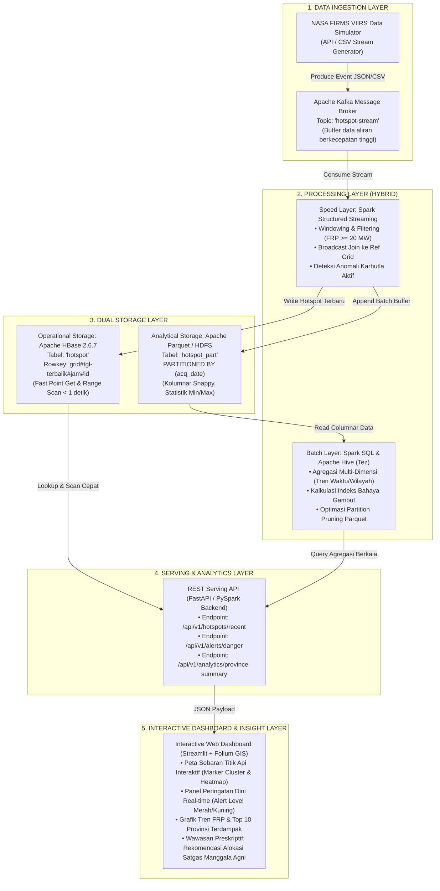
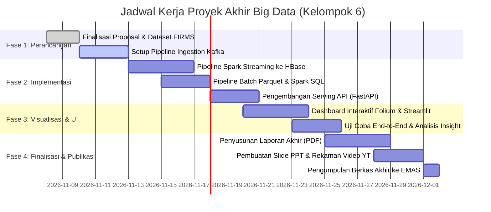

# RANCANGAN TUGAS AKHIR (FINAL PROJECT) TEKNOLOGI BIG DATA

**Judul Proyek:**  
**Sistem Terpadu Pemantauan Spatio-Temporal Titik Api (*Hotspot*) dan Peringatan Dini Kebakaran Hutan & Lahan di Indonesia Menggunakan Arsitektur Big Data End-to-End (Kafka, Spark Streaming, HBase, Parquet, Hive, dan Dashboard Interaktif)**

**Kelompok:** Kelompok 6  
**Anggota Tim:**
1. Muhammad Bryan Farras (NPM: 2306230975)
2. Mirza Adi Raffiansyah (NPM: 2306210323)
3. Calvin Wirathama Katoroy (NPM: 2306242395)
4. Salim (NPM: 2306204604)

---

## I. Definisi Masalah & Justifikasi Big Data (The 4V's)

### 1. Latar Belakang Masalah
Kebakaran hutan dan lahan (karhutla) di Indonesia merupakan bencana lingkungan menahun yang berdampak pada kerusakan ekosistem gambut, kerugian ekonomi miliaran dolar, hingga polusi kabut asap lintas batas negara (*transboundary haze*). Satelit penginderaan jauh modern seperti **NASA FIRMS VIIRS (Visible Infrared Imaging Radiometer Suite)** pada satelit Suomi-NPP dan NOAA-20 menghasilkan pembacaan anomali termal resolusi tinggi (375 meter) secara berkelanjutan di seluruh kepulauan Indonesia.

Tantangan utama penanggulangan karhutla adalah **keterlambatan deteksi dini** dan **keterbatasan sistem komputasi konvensional** dalam mengolah data spasial berkecepatan tinggi, memfilter ribuan titik api secara *real-time*, serta menyajikan analisis tren historis multi-tahun secara bersamaan.

### 2. Mengapa RDBMS Tradisional Gagal? (The 4V's Justification)

| Dimensi Big Data | Karakteristik Data Titik Api Satelit | Mengapa RDBMS Tradisional (MySQL/PostgreSQL) Gagal? | Solusi Arsitektur Big Data yang Dipilih |
|---|---|---|---|
| **Volume** | Arsip data satelit VIIRS wilayah Indonesia menghasilkan **puluhan ribu titik api per bulan** pada musim kemarau. Akumulasi historis 10 tahun mencapai **±85 juta baris** (berukuran puluhan hingga ratusan gigabita). | Indeks *B-Tree* RDBMS membengkak; query agregasi multi-tahun mengalami *table lock* atau *disk thrashing*, memakan waktu puluhan detik hingga *timeout*. | **Apache Parquet (Columnar)** terkompresi Snappy dengan *Partition Pruning* per tanggal (`acq_date`) + **Apache Hive** & **Spark SQL**. |
| **Velocity** | Data observasi satelit NASA FIRMS masuk secara berkala melalui feed API (ribuan deteksi per *pass* satelit) yang harus segera diproses dalam hitungan detik untuk sistem peringatan dini. | RDBMS mengalami bottleneck I/O saat melakukan *high-frequency concurrent write* secara serentak sambil melayani kueri analitik berat (*write contention*). | **Apache Kafka** sebagai *message broker* terdistribusi untuk *in-flight buffer*, dilanjutkan **Spark Structured Streaming** berlatensi rendah (<2 detik). |
| **Variety** | Data spatio-temporal numerik/kategorikal (koordinat, FRP, tingkat keyakinan, suhu kecerahan) digabungkan dengan batas administrasi poligon spasial (239 sel grid 1°×1°, peta provinsi, dan batas lahan gambut). | RDBMS tidak efisien menggabungkan (*join*) relasi spasial berukuran besar dalam waktu nyata tanpa indeks GIS kompleks yang memakan memori sangat besar. | **Apache Spark Broadcast Hash Join** di memori untuk menggabungkan stream titik api dengan tabel dimensi referensi provinsi & kawasan rawan. |
| **Veracity** | Deteksi satelit mengandung *noise* (*false alarms* akibat pantulan panas atap industri, cerobong flare kilang migas, atau anomali sensor berskala rendah). | Query analitik RDBMS lambat dalam menerapkan kalkulasi statistik bergerak (misal: *moving average* FRP atau filter konfirmasi multi-kriteria). | Filter kualitas bertingkat di lapisan streaming: pemisahan kelas `nominal`, `high`, serta ambang batas radiasi termal (*FRP* ≥ 10–50 MW). |

---

## II. Karakteristik Data & Alur Pemrosesan

### 1. Sumber Data
* **Data Titik Api Primer**: Satelit **VIIRS NASA FIRMS** (dataset sea_fires 7-hari Topic 9 & 10 yang diperbesar hingga skala penuh), memuat:
  * `hotspot_id`, `latitude`, `longitude`, `brightness`, `scan`, `track`, `acq_date`, `acq_time`, `satellite`, `confidence` (`low`, `nominal`, `high`), `version`, `bright_t31`, `frp` (Fire Radiative Power dalam MW), `daynight` (`D`/`N`).
* **Data Dimensi Referensi**:
  * `ref_grid_provinsi.csv` (239 sel grid 1°×1° memetakan koordinat ke Provinsi, Pulau, Tingkat Kerawanan Kebakaran, dan Estimasi Luas Lahan Gambut).

### 2. Sifat Pemrosesan (Dual-Path Processing)
Proyek menerapkan pola **Hybrid Architecture (Lambda/Kappa)**:
1. **Speed Layer (Real-time / Stream Processing)**:
   * Mengonsumsi event titik api dari Kafka Topic secara *streaming*.
   * Memfilter titik api dengan intensitas ekstrem (`frp >= 20 MW` & `confidence = 'high'`).
   * Melakukan *enrichment* (join sel grid ke provinsi) dan memicu notifikasi peringatan dini bahaya karhutla (*early warning alert*) dalam hitungan detik.
   * Menulis titik api terbaru ke **Apache HBase** untuk kebutuhan pencarian cepat peta operasional.
2. **Batch Layer (Analitik Historis Skala Besar)**:
   * Mengumpulkan data mentah ke *Data Lake* dalam format kolumnar **Apache Parquet** berpartisi tanggal (`acq_date`).
   * Menjalankan kueri agregasi skala besar di **Apache Spark SQL** dan **Apache Hive** untuk menyusun matriks risiko provinsi, tren kebakaran harian/bulanan, dan indeks keparahan radiasi panas.

---

## III. Arsitektur Solusi (Solution Architecture)

---

## IV. Tech Stack Lengkap

| Lapisan Sistem | Teknologi / Alat | Alasan Pemilihan & Justifikasi Teknis |
|---|---|---|
| **Ingestion** | **Apache Kafka 3.x** | Mengisolasi produsen data satelit dari konsumen analitik, menangani lonjakan aliran (*backpressure*), serta menjamin *at-least-once delivery*. |
| **Stream Processing** | **Apache Spark Structured Streaming (PySpark 4.2.0)** | Memproses stream mikro-batch di memori, mendukung agregasi *sliding window*, dan memungkinkan penggunaan logika SQL yang sama persis dengan batch. |
| **Batch Processing** | **Apache Spark SQL 4.2.0 & Apache Hive 4.2.1 (Tez)** | Spark SQL memberikan kecepatan in-memory sub-detik untuk kueri harian, sementara Hive menyediakan katalog Metastore enterprise dan akses JDBC/BI. |
| **Operational Storage** | **Apache HBase 2.6.7 (NoSQL Column-Family)** | Menyediakan pembacaan berlatensi milidetik (*random read*) untuk menampilkan titik api satu sel grid pada antarmuka peta pengguna (*Topic 9*). |
| **Analytical Storage** | **Apache Parquet (Snappy Compressed)** | Mengurangi volume penyimpanan hingga >60%, memangkas I/O disk melalui *column projection* dan *partition pruning* pada filter tanggal (*Topic 10*). |
| **Serving Layer** | **FastAPI (Python)** | Framework REST API modern asinkron dengan throughput tinggi untuk menghubungkan backend Big Data ke visualisasi antarmuka. |
| **Visualisasi** | **Streamlit + Folium (Leaflet GIS) + Plotly** | Membangun dashboard analitik interaktif berbasis peta geospatial (Heatmap & Cluster), filter dinamis, dan visualisasi tren waktu nyata. |

---

## V. Rancangan Visualisasi & Wawasan Preskriptif (Target Nilai Sangat Baik / A)

Untuk memenuhi rubrik nilai tertinggi (**Visualisasi Interaktif & Memberikan Wawasan Preskriptif Mendalam**), dashboard tidak hanya menampilkan grafik deskriptif biasa, melainkan:

1. **Peta Interaktif Spatio-Temporal (Folium GIS)**:
   * **Heatmap Intensitas FRP**: Memetakan konsentrasi radiasi panas kebakaran di pulau Sumatera dan Kalimantan.
   * **Marker Clustering**: Pengelompokan titik api dinamis yang dapat di-*zoom* hingga level koordinat satelit 375m.
   * **Layer Wilayah Rawan**: Peta poligon 239 sel grid yang diberi warna berdasarkan tingkat bahaya (Hijau = Aman, Kuning = Waspada, Merah = Bahaya Ekstrem).
2. **Panel Peringatan Dini Karhutla Real-Time**:
   * Ticker notifikasi langsung saat terdeteksi *cluster* titik api dengan total FRP > 100 MW dalam satu sel grid.
3. **Wawasan Preskriptif (Decision Support / Rekomendasi Tindakan)**:
   * **Rekomendasi Prioritas Pemadaman**: Sistem secara otomatis mengurutkan sel grid prioritas berdasarkan kombinasi: *FRP maksimum*, *kepadatan titik api*, dan *kedekatan dengan lahan gambut*.
   * **Rekomendasi Penempatan Satgas**: Estimasi kebutuhan alokasi water-bombing helikopter BNPB dan satgas darat Manggala Agni untuk sel-sel berkategori darurat (misal: sel `g086113` di Kalimantan Tengah).

---

## VI. Struktur Laporan Akhir (Sesuai Panduan Bagian V)

Laporan akhir akan disusun dalam format PDF dengan sistematika resmi:
* **Halaman Judul & Identitas Tim Kelompok 6**
* **Abstrak** (Bahasa Indonesia & Bahasa Inggris)
* **Bab 1: Pendahuluan**
  * 1.1 Latar Belakang Masalah (Kebakaran Hutan, Kerugian Ekologis, Satelit VIIRS).
  * 1.2 Rumusan Masalah (Keterbatasan RDBMS, Latensi Deteksi, Volume Spatio-Temporal).
  * 1.3 Tujuan Proyek (Membangun sistem end-to-end terintegrasi dari Ingestion hingga Dashboard).
* **Bab 2: Tinjauan Pustaka & Justifikasi Big Data**
  * 2.1 Teori Big Data (Karakteristik 4V: Volume, Velocity, Variety, Veracity).
  * 2.2 Tinjauan Teknologi (Kafka, Spark Streaming, HBase, Parquet, Hive, Streamlit).
  * 2.3 Perbandingan Sistem RDBMS Tradisional vs Arsitektur Terdistribusi.
* **Bab 3: Metodologi & Perancangan Solusi**
  * 3.1 Diagram Arsitektur Solusi End-to-End (Lambda Architecture).
  * 3.2 Desain Skema Data (HBase Rowkey, Parquet Schema, Tabel Partisi).
  * 3.3 Alur Kerja Pipeline (Ingestion -> Stream Filter -> Batch Aggregation -> Serving).
* **Bab 4: Implementasi & Hasil Analisis**
  * 4.1 Implementasi Ingestion (Kafka Producer & Consumer Scripts).
  * 4.2 Implementasi Pemrosesan (Spark Streaming & Spark SQL Benchmark).
  * 4.3 Implementasi Penyimpanan (HBase & Parquet Data Lake).
  * 4.4 Implementasi Dashboard Visualisasi Interaktif.
  * 4.5 Pembahasan Hasil, Evaluasi Performa (Latency, Throughput, Skalabilitas), dan Wawasan Preskriptif.
* **Bab 5: Kesimpulan & Saran**
  * 5.1 Kesimpulan (Keberhasilan solusi mengatasi tantangan 4V).
  * 5.2 Saran Pengembangan Masa Depan (Integrasi Machine Learning prediksi arah sebaran asap).
* **Daftar Pustaka** (Referensi akademis, dokumentasi Apache, data NASA FIRMS).

---

## VII. Roadmap & Pembagian Tugas Anggota (Kelompok 6)

| Anggota Tim | NPM | Peran & Tanggung Jawab Utama | Target Luaran Teknis |
|---|---|---|---|
| **Muhammad Bryan Farras** | 2306230975 | **Lead Architect & Stream Engineer** | Konfigurasi Apache Kafka, pembuatan Kafka Producer (simulator feed satelit), integrasi Spark Structured Streaming untuk filter real-time, dan penulisan Bab 1 & Bab 4 (Streaming). |
| **Mirza Adi Raffiansyah** | 2306210323 | **Storage & Batch Processing Engineer** | Pengelolaan Apache HBase 2.6.7 (Topic 9), optimasi skema Parquet berpartisi tanggal di HDFS/Local, query agregasi Spark SQL & Hive (Topic 10), dan penulisan Bab 2 & Bab 3. |
| **Calvin Wirathama Katoroy** | 2306242395 | **Serving & Backend Engineer** | Pengembangan REST API (FastAPI) untuk jembatan data HBase/Spark ke UI, integrasi lingkungan Docker & WSL2, penyiapan benchmark latensi end-to-end, dan penulisan Bab 4 (Implementasi Teknis). |
| **Salim** | 2306204604 | **Visualization & Project Lead** | Pembuatan Interactive GIS Dashboard (Streamlit + Folium Heatmap/Cluster), perancangan modul analitik preskriptif, kompilasi Laporan PDF, pembuatan PPT, dan koordinasi Video Presentasi YouTube. |

---

## VIII. Timeline Pengerjaan Proyek Menuju Pengumpulan

